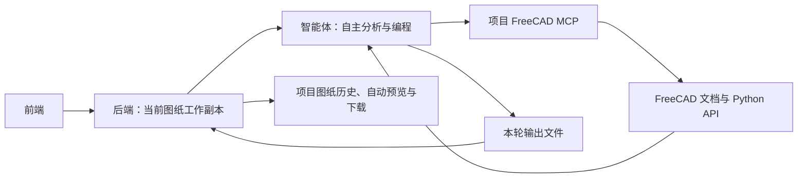

# CAD Agent

通过网页向智能体提出图纸任务，由智能体调用原版 FreeCAD MCP，自主编写、执行和修正 Python，并交付文件。网页只有这一条编辑链路；旧的固定 CAD 操作工具和内部编辑接口已移除。

## 日常启动

环境已安装时，在项目根目录运行：

```bash
bash scripts/dev.sh
```

打开 **http://127.0.0.1:5173**。保持启动终端和 FreeCAD 窗口打开，按一次 **Ctrl+C** 停止全部服务。

| 程序 | 端口 | 用途 |
| --- | --- | --- |
| FreeCAD 与插件 | 9875 | 执行智能体生成的 Python、操作图纸文档 |
| 后端 | 8000 | 上传、任务文件、成果管理和预览 |
| 智能体 | 4096 | 模型对话、工具调用与自主纠错 |
| 前端 | 5173 | 图纸、对话和成果文件界面 |

MCP 使用标准输入输出，由智能体自动启动。4097 实验服务已合并移除；原来的 `--freecad` 参数仍可使用，但不再需要。缺少 FreeCAD 时启动会报错，不会退回旧编辑工具。

启动前会检查所有服务端口是否可以监听；停止后的正常 `TIME_WAIT` 连接不会阻止再次启动。若失败，终端会显示端口诊断，并保存到 `.runtime/startup-errors.log`。脚本只停止自己启动的服务，不会自动结束占用端口的其他程序。

## 怎样使用

1. 左侧是可收起的工程项目栏，可新建、重命名和切换项目。上传的 DWG/DXF 加入当前项目，原有图纸按已有项目关系保留。
2. 右上角用 `v0001_文件名`、`v0002_总平面图` 等名称集中展示项目内图纸及历史。网页默认显示 SVG，仍可切换 PNG 概览。
3. 在左侧对话区提出任务。智能体按原有方式自主检查、编写和执行脚本，修改发生在工作副本中。
4. 任务完成且新 CAD 文件预览就绪后，右侧自动显示新图纸，原会话继续使用该成果。一次生成多张图时，等待预览处理结束后显示最后一张可用成果，其余保留在下拉列表。
5. 从下拉菜单查看历史图纸不会改变会话目标；此时输入区只读，点击 **回到当前版本** 后继续。右侧 **PNG / DXF / DWG** 按钮下载当前查看的图纸，CSV、图片、报告等在同一区域的 **文件** 菜单中下载。

项目图纸名称是展示用的连续编号，内部图纸 ID 和 `r0001` 等修订 ID 保持不变，原文件不会被重命名或覆盖。纯分析、报告输出以及预览失败不会替换当前图纸。FreeCAD 仍是共享进程，同一时间只执行一个智能体任务。

停止对话会请求模型中断并禁止发布本轮成果。FreeCAD 已经开始的 Python 操作可能无法立即打断，网页会等待其结束；卡住时在启动终端按 Ctrl+C 停止全部服务后重新启动。

**当前优先验证自主执行循环。** FreeCAD 导入导出的单位、坐标、块、文字、中文及专业对象保真问题暂缓修复。文件“可打开”只表示已经生成预览，不代表工程内容已验收；请结合模型报告和文件本身检查。

## 项目架构



```text
cad-agent/
├── frontend/             网页：上传、SVG 看图、对话、成果文件
├── backend/app/
│   ├── api/              网页接口；无旧 /internal 编辑接口
│   ├── agent_tasks.py    工作副本、串行任务、停止、收集成果
│   ├── freecad.py        FreeCAD 状态检查
│   ├── jobs.py           导入、预览、格式转换的后台任务
│   ├── cad/              文件读取、预览和转换；没有固定编辑操作
│   └── store.py          图纸、会话、文件任务和成果索引
├── agent/
│   ├── launcher.py       唯一智能体入口
│   ├── config.json       模型及 FreeCAD MCP 配置
│   ├── prompts/cad.txt   自主工作方式、CAD API 导航与文件范围约定
│   ├── plugins/          当前任务上下文注入（发行版和源码模式共用）
│   ├── session.py        内部消息过滤与答复完成判定
│   ├── client.py         后端与智能体的 HTTP 通信
│   ├── runtime.py        运行环境与源码/发行程序选择
│   └── engine/           可修改的智能体引擎源码
├── freecad/
│   ├── mcp/              项目 MCP 源码（主仓库直接管理）
│   ├── runtime/          官方软件、DXF 可选库及 python-deps/ 专用依赖
│   ├── requirements-python.txt  FreeCAD 额外 Python 依赖清单
│   ├── install.sh        安装软件、依赖与插件
│   └── start.sh          启动 FreeCAD 和原版插件
├── cad_converter/        ODA 转换器安装、启动及运行文件
├── scripts/              整个项目的安装、启动、诊断
├── samples/private/      本机工程样本，不提交 Git
├── assets/fonts/local/   用户字体，不提交 Git
├── data/                 图纸、任务和成果，不提交 Git
├── .runtime/             智能体记录、FreeCAD 配置和日志
├── .tools/               Node、Bun、uv 等本机工具
└── .venv/                后端 Python 环境
```

前端的图纸、版本、会话标识由后端转换成明确的文件上下文。每轮目录为 `data/agent-tasks/<任务ID>/`，包含 `input/`、`scratch/`、`output/` 和 `context.json`。原上传文件仍在 `data/drawings/`；成果快照保存到 `data/artifacts/`，记录来源、哈希和后续图纸。

同一版本已有的 PNG 总览会作为视觉输入随提问发送给模型，并保存为只读 `input/overview.png`；精确数据仍从 DXF/DWG 查询。这样模型可以看到前端对应图纸，不必仅为看总览重新导入 FreeCAD。无效、缺失或过大的预览会在上下文中注明并跳过，不会取别的版本代替，也不会阻断文件分析。

当前活跃任务另有一个 `data/agent-contexts/<会话ID>.json` 绑定。智能体插件在每次模型调用、历史压缩和 Python 执行前读取它，并向脚本提供 `cad_context` 字典；其中包含本轮输入、输出、原始要求及 FreeCAD 专用依赖信息。任务结束后清除活跃绑定，原始 `context.json` 仍保留用于排查。这样目录与环境事实不会只依赖模型记忆。明确使用旧任务路径的脚本会收到纠正提示；这项检查不是 Python 沙箱。

模型停止生成不等于任务成功：内部压缩摘要不会显示成助手答复；输出截断、空答复或压缩后持续空闲会在同一文件任务内最多续跑两次。正常工具循环不受这个次数限制。只有正式答复正常结束、引擎与 FreeCAD 均已空闲，后端才检查并发布成果；仍未完成则明确失败。

后端不解释“提取什么”或“怎样修改”，也不提供逐场景的编辑菜单。具体做法由智能体通过 FreeCAD API 组合。后端保留 ezdxf/ODA 用于上传、预览和下载转换，不作为智能体的备用编辑入口。

## 安装到新主机

目前面向 Linux x86_64 / WSL2，FreeCAD 图形窗口需要可用的 Linux 桌面或 WSLg。Python 依赖以 `pyproject.toml` 和 `uv.lock` 为准；仅安装 Python 包不足以运行整个项目。

```bash
git clone <你的仓库地址> cad-agent
cd cad-agent
bash scripts/bootstrap.sh
bash cad_converter/install.sh
bash freecad/install.sh
```

在 `.env` 配置模型连接与智能体认证；不要提交真实凭据。`.env.example` 是配置模板，新字段应同步维护两份文件。已有主机保留 `.env`，安装脚本不会覆盖有效密码。

FreeCAD 执行环境的额外依赖在 `freecad/requirements-python.txt` 中管理，安装到 `freecad/runtime/python-deps/`。新增依赖后运行 `bash freecad/install_python.sh`，再重新一键启动；GUI 与无界面 MCP 都能使用。详见 [依赖维护说明](freecad/README.md#给-freecad-补充-python-依赖)。

`freecad/mcp/` 由本仓库直接管理源码，插件通过软链接加载，普通克隆即包含当前修改，无须初始化子模块或应用补丁。MIT 许可证和上游来源记录保留；Python 错误反馈修复已直接纳入源码。修改 MCP 服务源码后重启智能体；修改插件后重启全部服务。不要把后端 `.venv` 的包复制到 FreeCAD 自带 Python。

## 后续修改入口

| 需要修改什么 | 主要位置 |
| --- | --- |
| 智能体怎样探索、执行和报告 | `agent/prompts/cad.txt` |
| 模型、工具和引擎配置 | `agent/config.json`、`agent/launcher.py` |
| 当前任务绑定与历史压缩后的上下文 | `agent/plugins/task-context.mjs`、`backend/app/agent_tasks.py` |
| 消息显示、内部摘要过滤与答复完成判定 | `agent/session.py`、`backend/app/api/chat.py` |
| 文件交接、成果、取消与会话继续 | `backend/app/agent_tasks.py`、`backend/app/api/artifacts.py` |
| CAD API 执行与插件 | `freecad/mcp/src/`、`freecad/mcp/addon/` |
| 网页对话与成果展示 | `frontend/src/components/ChatPanel.tsx`、`frontend/src/App.tsx` |
| 图纸导入与预览 | `backend/app/cad/` |

修改 `agent/engine/` 源码后，可以用源码模式启动：

```bash
bash agent/install.sh --source
AGENT_RUNTIME=source bash scripts/dev.sh
```

发行程序与源码模式使用相同的 FreeCAD 工具配置。源码依赖和来源记录见 `agent/source.lock.json`。更改源码不等于自动更新发行程序。

## 日志与验证

- 后端日志在启动终端；智能体服务日志：`.runtime/agent/server.log`。
- 完整模型会话、代码与工具反馈保存在 `.runtime/agent/data/opencode/`。
- FreeCAD 日志：`.runtime/freecad/gui.log`。
- 启动失败与退出时的端口诊断：`.runtime/startup-errors.log`。
- 本轮文件上下文：`data/agent-tasks/<任务ID>/context.json`；发生自动续跑时另有 `recovery.json`。

```bash
source scripts/env.sh
pytest -q
node --test tests/task-context.test.mjs
ruff check agent/*.py backend scripts tests
npm run build --prefix frontend
npm run test:e2e --prefix frontend
python scripts/verify_agent.py
```

缓存和软件不要混为一谈：`.cache/` 可以清理并重新生成；`.tools/`、`.venv/`、组件 `runtime/` 删除后需要重新安装。`data/` 和 `.runtime/agent/` 含图纸、成果及会话，请按项目数据保留。

[智能体循环排查与复测](docs/agent-loop-validation.md) · [FreeCAD 安装与诊断](freecad/README.md) · [环境说明](docs/environment.md) · [本次自主执行接入](docs/autonomous-agent.md) · [早期 FreeCAD 文件兼容性实测](docs/freecad-validation.md)

初始部署指南和需求表保留作为历史材料；实际能力、目录和启动方式以本 README 为准。
