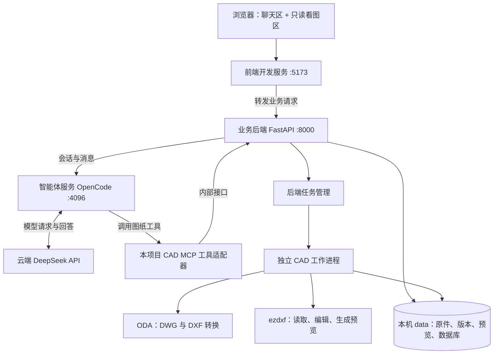

# CAD 图纸助手 · 第一阶段原型

这是一个在本机运行的 CAD 工作台。你在浏览器里操作，图纸文件在本机处理，智能对话通过 OpenCode 调用 DeepSeek 云端 API。

**这台机器的项目环境已经配置完成。** 之前开发验收时已经启动服务并保留运行，因此现在可以直接访问页面。环境安装和服务启动是两件事：安装完成后文件会保留；服务是正在运行的进程，重启电脑或停止进程后，需要重新启动。

本文先说明项目如何组成、如何运行，再说明目录清理和新主机安装。更细的接口与版本事务说明在 [后端架构文档](docs/architecture.md)。

阅读顺序：第 1 节解释当前服务，第 2 节解释架构，第 3 节讲启动和日志，第 4–5 节讲目录与依赖，第 6 节讲换电脑安装。

## 1. 为什么没有手动启动服务，也能访问网页？

因为上一轮开发时已经执行了 `bash scripts/dev.sh`，启动的服务仍然在运行。日志输出在当时启动它们的执行终端里，不会自动出现在你后来打开的终端中。

默认开发模式有三个长期运行的服务：

| 服务 | 地址 | 负责什么 | 停止后会怎样 |
| --- | --- | --- | --- |
| 前端开发服务 Vite | `http://127.0.0.1:5173` | 把 React 网页交给浏览器，并把 `/api` 请求转发到后端 | 无法重新打开开发页面 |
| 业务后端 FastAPI | `http://127.0.0.1:8000` | 上传、图纸信息、版本、任务、预览、下载及会话代理 | 页面可能还能显示，但新的业务操作无法完成 |
| 智能体服务 OpenCode | `http://127.0.0.1:4096` | 管理对话，调用 DeepSeek，执行 CAD 工具 | 智能对话不可用，本地上传和看图仍可使用 |

`127.0.0.1` 表示访问本机。当前进程运行在 Ubuntu / WSL2 中，网页可以从本机浏览器打开。能打开 5173 的页面只能证明前端服务可访问，不能单独证明后端和智能体都正常。

本项目没有配置开机自启、systemd 常驻服务或 Docker 自动启动。关闭浏览器不会停止服务；服务也不是由浏览器启动的。

### 怎样查看服务和日志？

在 Ubuntu / WSL 终端执行以下只读命令：

```bash
# 查看三个端口是否有进程监听，以及对应 PID（进程编号）
ss -ltnp '( sport = :5173 or sport = :8000 or sport = :4096 )'

# 查看后端健康状态；--noproxy 避免本机检查被交给网络代理
curl --noproxy '*' http://127.0.0.1:8000/api/health

# 查看统一启动脚本对应的主进程
pgrep -af 'python.*scripts/dev[.]py'
```

健康结果中，`status: "ok"` 表示业务后端响应正常，`opencode: "connected"` 表示能连接智能体服务，`dwg_available: true` 表示配置的转换器入口文件存在；真实转换能力仍以样图测试为准。`rag: "not_configured"` 是本阶段的预期状态。

想在自己的终端看到持续日志，可以先停止原来的启动进程，再自己执行启动命令。如果原终端可用，按 `Ctrl+C`；如果原终端不在手边，先用上述 `pgrep` 核对本项目的 `scripts/dev.py` 主进程，再向**核对过的主进程 PID** 发送 `kill -TERM PID`。其中 `PID` 要替换成查询到的数字，不要照抄历史进程编号。主进程会负责关闭它启动的三个服务。

## 2. 项目到底由哪些部分组成？

### 整体结构



图里只有 DeepSeek 是云端服务，其余部分都在本机。上传的 DWG/DXF 原件由本地服务保存和处理；使用智能对话时，工具查出的文字或渲染的图片会根据任务提供给模型。没有在本机下载 DeepSeek 模型权重，也不需要为模型推理配置 GPU。

### 各部分用通俗语言解释

| 部分 | 可以怎样理解 | 在项目中的位置 |
| --- | --- | --- |
| React 前端 | 你看到的网页，负责按钮、对话显示、图纸展示 | `frontend/src/` |
| Vite | 开发期间把这个网页提供给浏览器的程序 | 安装在 `frontend/node_modules/` |
| FastAPI 后端 | 接收网页请求，管理图纸、任务和版本的程序 | `backend/app/` |
| OpenCode | 负责组织模型对话和工具调用的智能体程序 | 安装在 `.tools/opencode/` |
| DeepSeek | 理解你的问题、决定下一步调用什么工具的云端模型 | 配置在 `.env`，本地没有模型目录 |
| CAD MCP | 告诉 OpenCode“有哪些图纸工具可调用”，再把调用转到后端；MCP 是工具通信协议 | `cad_mcp/`，是本项目编写的适配代码 |
| CAD worker | 后端启动的独立 Python 进程，专门做较慢的转换、读取和渲染 | 由 `backend/app/jobs.py` 管理 |
| ODA File Converter | 把 DWG 转为 DXF，或把 DXF 转回 DWG 的外部程序 | `.tools/oda/` |
| ezdxf | 操作 DXF 中的文字、线条、图层等实体的 Python 库，也参与预览生成 | 安装在 `.venv/`；业务代码在 `backend/app/cad/` |
| SQLite | 保存图纸、版本、任务和会话对应关系的本地数据库文件，无需另启动数据库服务 | `data/app.sqlite` |

CAD MCP 由 OpenCode 自动启动，通过进程输入输出通信，不额外占一个网页端口。CAD worker 由后端按任务启动，不需要你单独开终端。SQLite 也是文件，不需要安装和启动 MySQL。

### “CAD 看图库”实际上是哪一个？

当前看图功能由两端配合完成：

- **后端解析与绘图：** ODA 转换 DWG，ezdxf 读取工作 DXF，绘图代码生成 SVG/PNG 预览。
- **前端展示与操作：** 浏览器显示这些 SVG/PNG，`react-zoom-pan-pinch` 提供缩放、平移和适应窗口。

因此，前端没有安装一个能直接解析 DWG 的完整 CAD 引擎。右侧展示的是当前图纸版本生成的预览，不能在右侧拖动图元编辑。修改从左侧对话发起，由后端操作 DXF 后生成新的预览。

### 上传一张图纸时，发生了什么？

1. 浏览器把文件上传给 FastAPI。
2. 后端保存原始文件，登记一个导入任务。
3. 如果是 DWG，worker 调用 ODA 转成 DXF；如果是 DXF，直接建立工作副本。
4. ezdxf 读取单位、图层、文字和实体，生成预览。
5. 后端登记第一个版本 `r0001`，前端显示图纸。

**这个流程不需要 DeepSeek。** 模型服务暂时不可用时，上传和本地看图仍可以工作。

### 对助手说“修改这段文字”时，发生了什么？

1. 网页把问题和当前版本号交给 FastAPI，后端转给 OpenCode。
2. OpenCode 请求 DeepSeek 理解任务，模型选择查询或编辑工具。
3. OpenCode 调用 CAD MCP，MCP 通过内部接口把任务交给同一个后端。
4. worker 修改图纸副本、重新读取校验、生成预览。
5. 后端发布 `r0002`；`r0001` 和上传原件保留。
6. 后端把“新版本已发布”的事件推送给网页，右侧刷新，左侧显示助手说明。

页面中的逐字回答和任务更新通过 SSE 实现；这里可以把 SSE 理解为“服务器持续向网页推送消息的一条连接”。并不是模型说了“完成”，网页就自行认定图纸已经修改成功。

## 3. 怎么启动、停止？

### 日常开发：一个终端统一启动

在**项目根目录**执行：

```bash
bash scripts/dev.sh
```

启动后访问 **http://127.0.0.1:5173**，终端中可以看到服务输出。按 `Ctrl+C` 统一停止。若提示端口已占用，先按第 1 节核对已有进程，不要重复启动第二套。

这条命令实际做了以下事情：

```text
scripts/dev.sh
  ├─ 加载 scripts/env.sh：让当前进程优先使用项目里的 Node、uv 和 Python
  └─ 运行 scripts/dev.py
       ├─ 启动 FastAPI      :8000
       ├─ 启动 OpenCode     :4096（OpenCode 再启动 CAD MCP）
       └─ 启动 Vite         :5173
```

`source scripts/env.sh` 只把本项目工具目录加入**当前终端**的 PATH 等环境变量，并不启动服务，也不读取 `.env` 中的密钥。因此，在一个全新的终端直接输入 `node` 找不到命令，并不表示项目没有安装 Node；先加载这个脚本即可。`dev.sh` 已经自动完成这一步。

### 想分别观察服务：开三个终端

先停止统一启动的那一套。以下三个终端都从项目根目录开始：

```bash
# 终端 A：业务后端
source scripts/env.sh
python -m uvicorn backend.app.main:app --host 127.0.0.1 --port 8000 --workers 1
```

```bash
# 终端 B：智能体服务；启动脚本会读取 .env
source scripts/env.sh
python scripts/start_opencode.py
```

```bash
# 终端 C：前端开发服务
source scripts/env.sh
npm run dev --prefix frontend
```

此时每个终端只显示对应服务的输出，停止时分别按 `Ctrl+C`。统一启动和分开启动是两种可选方式，不要同时运行。

### 使用构建后的页面：访问 8000

先停止开发模式，再执行：

```bash
source scripts/env.sh
npm run build --prefix frontend
bash scripts/dev.sh --production
```

此模式中，网页已经编译到 `frontend/dist/`，由 FastAPI 同时提供网页和 API，所以访问 **http://127.0.0.1:8000**。仍需运行 FastAPI 和 OpenCode，但不再启动 Vite，也就没有 5173 服务。这是使用构建产物运行的模式，脚本本身没有添加开机自启或服务器进程守护。

只验证文件和看图功能可以执行 `bash scripts/dev.sh --without-agent`。API 文档在 **http://127.0.0.1:8000/docs**。

## 4. `.cache`、`.tools` 等目录是什么，能删除吗？

这些目录的存在表示本项目的依赖和运行数据放在了项目里，**不是环境还没安装完成**。本次采用项目内安装，是为了让这个项目使用自己的工具版本，减少对系统 Python、Node 和其他项目的影响。开头的点表示 Linux 隐藏目录，没有“可以随便删除”的含义。

| 目录或文件 | 存的是什么 | 删除的影响 / 如何恢复 |
| --- | --- | --- |
| `.cache/` | 安装包下载缓存、Python/npm 缓存、字体缓存、Playwright 测试浏览器 | 可按需清理缓存；下次可能重新下载或生成。删掉测试浏览器后需重装才能跑浏览器测试，正常使用你自己的浏览器不受影响 |
| `.tools/` | 实际使用的 Node、uv、OpenCode 和 ODA 程序 | **运行依赖，不是缓存。** 删除后服务无法正常启动；需重新执行环境安装和 ODA 安装步骤 |
| `.venv/` | 项目的 Python 虚拟环境，包含 FastAPI、ezdxf、MCP 等已安装库 | 删除后后端不能运行；用 `source scripts/env.sh` 后的 `uv sync --frozen` 重建 |
| `frontend/node_modules/` | React、Vite、缩放组件等前端依赖 | 删除后前端开发/构建不能运行；加载 `scripts/env.sh` 后用 `npm ci --prefix frontend` 重装 |
| `frontend/dist/` | 编译完成的网页 | 删除后需要重新构建才能使用 `--production` 模式；`npm run build --prefix frontend` 可重建 |
| `.runtime/opencode/` | OpenCode 的本地会话、状态和自身缓存 | **不能把整个目录当缓存清空。** 删除会丢失对话历史，后端保存的会话编号也可能失效 |
| `.runtime/vision-smoke/`、`.runtime/agent-cad-smoke/` | 模型验收的测试产物 | 不需要保留验收产物时可删，不影响主应用运行 |
| `data/` | 上传原件、修改后的版本、预览、任务数据库和验收产物 | **属于业务数据。** 整体删除会丢失图纸和版本记录；清理前先备份，不要把它等同于安装缓存 |
| `.pytest_cache/`、`.ruff_cache/`、`__pycache__/` | 测试、检查和 Python 字节码缓存 | 可以清理，后续自动生成 |
| `.env` | 当前主机的模型密钥和服务配置 | 运行所需配置，应妥善保留；不要上传公开仓库 |
| `assets/fonts/noto/` | 随代码分发的两款开源中文字体及许可证 | 看图回退字体，应保留；克隆仓库即可获得 |
| `samples/private/` | 本机真实工程测试图纸 | 不进入 Git；需要时单独备份和迁移 |
| `backend/`、`cad_mcp/`、`frontend/src/`、`scripts/`、`prompts/` | 本项目源码与启动脚本 | 属于项目本身，正常使用时保留 |

2026-09-21 核对时，`.cache/` 约 **1.6 GB**，其中 Playwright 测试浏览器约 658 MB、npm 缓存约 541 MB；`.tools/` 约 **864 MB**。这些数字会变化。如果只是为了释放空间，先考虑不用的下载/包缓存及测试浏览器，保留运行程序和业务数据。

建议停止服务和安装任务后再做目录清理。

其中 `.cache/downloads/` 是已下载的安装包，不是 ODA 已安装的程序。删它不影响正常看图；但当前 `install_oda.sh` 末尾会核对该目录里的 ODA 安装包哈希，若以后再次执行安装脚本，需保留或重新下载该安装包。浏览器测试的恢复命令为：

```bash
source scripts/env.sh
cd frontend
npx playwright install chromium
```

## 5. OpenCode 和 CAD 库已经下载了吗？需要克隆源码吗？

**本机运行需要的程序和库都已安装，不需要你再下载一遍。** 当前采用“安装发布包”的方式，没有把 OpenCode、ezdxf 等上游完整源码仓库逐个 `git clone` 到项目里。普通使用不需要克隆这些上游仓库。

| 组件 | 本次怎么获取 | 实际安装位置 | 控制安装版本的文件 |
| --- | --- | --- | --- |
| OpenCode | npm 安装 `opencode-ai` 发布包 | `.tools/opencode/node_modules/` | `tooling/opencode/package.json` 和 `package-lock.json` |
| ezdxf 等 Python 库 | uv 安装 Python 发布包 | `.venv/lib/python3.12/site-packages/` | `pyproject.toml` 和 `uv.lock` |
| React、Vite、缩放组件等 | npm 安装前端包 | `frontend/node_modules/` | `frontend/package.json` 和 `package-lock.json` |
| ODA File Converter | 下载官方 Linux AppImage 并解包运行 | `.tools/oda/` | `scripts/install_oda.sh` 中的安装包版本 |
| CAD MCP 与图纸业务逻辑 | 本项目编写的源码 | `cad_mcp/`、`backend/app/cad/` | 本项目源码 |

其中 `tooling/opencode/` 是需要保留的**安装清单和锁文件**，`.tools/opencode/` 是按该清单生成的**已安装程序**。名字相似，但用途不同。锁文件记录本次使用的具体依赖版本，方便换电脑时安装相同组合。

ODA 是外部非开源程序；本次下载的是可执行安装包，不是其源代码。当前方案也没有安装或依赖 FreeCAD、AutoCAD。

## 6. 新主机怎样从零部署？

**不能只安装一份 Python requirements 就运行整个项目。** 项目同时包含 Python 后端、Node 前端工具、OpenCode、ODA 和字体资源。本项目没有维护 `requirements.txt`，Python 依赖由 `pyproject.toml` 声明、`uv.lock` 锁定；`uv sync --frozen` 负责安装它们。

当前安装脚本针对 **Ubuntu 24.04 / Linux x86_64**，Windows 主机可以在 WSL2 Ubuntu 24.04 中执行。脚本里的 Node 和 ODA 下载包是 Linux x64 版本，不能直接在 Windows PowerShell、macOS 或 ARM 主机照搬执行。

### 第一步：准备系统基础环境

下面命令在新主机的 Ubuntu 终端执行；本机已经具备的依赖无需重复配置。

```bash
sudo apt update
sudo apt install -y \
  python3 python3-pip python3-venv \
  git curl ca-certificates tar xz-utils \
  fontconfig fonts-noto-cjk \
  xvfb xauth libgl1 libegl1 libxkbcommon-x11-0 libxcb-cursor0
```

Python 用来运行后端；字体用来生成中文预览。项目已经携带两款 Noto 中文字体，系统字体包可补充其他字重。Xvfb 是给没有桌面显示环境的 ODA 提供虚拟显示的程序。当前电脑使用 WSLg，也就是 WSL 提供的图形显示环境，已有显示时无需启用 Xvfb。ODA 的 Qt 图形依赖会受到具体发行版环境影响，安装后的转换测试是必要的核对步骤。

### 第二步：复制项目源码

使用有权限的 GitHub 账号克隆私有仓库 [Magnificent2003/cad-agent](https://github.com/Magnificent2003/cad-agent)，进入项目根目录；无需另行克隆 OpenCode 或 ezdxf 的上游仓库。

```bash
git clone https://github.com/Magnificent2003/cad-agent.git
cd cad-agent
```

至少保留 `backend/`、`cad_mcp/`、`frontend/` 的源码和配置、`assets/fonts/noto/`、`scripts/`、`prompts/`、`tooling/`、`opencode.json`、`pyproject.toml`、`uv.lock`、`.python-version` 和 `.env.example`。`samples/`、`tests/` 和文档也建议一起保留。

`.tools/`、`.venv/`、`frontend/node_modules/` 和缓存可以在新机器重新生成。不要把这些已安装目录当作跨系统可直接搬运的环境：它们可能包含特定平台的二进制文件或指向旧解释器的链接。

### 第三步：安装项目依赖

```bash
bash scripts/bootstrap.sh
```

这一个脚本按顺序完成：

1. 安装项目内的 uv 到 `.tools/uv/`。
2. 下载并校验 Node 24.21.0，安装到 `.tools/`。
3. 按 `uv.lock` 创建 `.venv/`，安装 Python 库。
4. 按 npm 锁文件安装 OpenCode 和前端依赖。
5. 构建前端到 `frontend/dist/`。
6. 从 `.env.example` 补齐本地 `.env`，生成内部服务令牌和 OpenCode 服务密码。

脚本不会安装第一步的系统软件，也不会安装下一步的 ODA；没有填写的 DeepSeek 密钥也需要你自己提供。它不会替换已有 `.env` 中的有效密钥。

### 第四步：安装 DWG 转换器

```bash
bash scripts/install_oda.sh
```

这个脚本从 ODA 官方下载 AppImage，解包到 `.tools/oda/`，生成转换器入口。它不需要你编译 ODA，也不需要安装 AutoCAD。只测试 DXF 文件时可以暂不安装 ODA，但 DWG 上传和 DWG 导出需要它。

### 第五步：填写本机配置

用编辑器打开项目根目录的 `.env`，重点检查：

| 字段 | 新主机如何处理 |
| --- | --- |
| `DEEPSEEK_API_KEY` | 填写有效密钥；这是安装脚本无法生成的内容 |
| `DEEPSEEK_BASE_URL`、`DEEPSEEK_MODEL` | 默认使用当前项目配置；换模型时需另做兼容性验证 |
| `CAD_INTERNAL_TOKEN`、`OPENCODE_SERVER_PASSWORD` | 安装脚本会生成，通常不用手动填写 |
| `ODA_EXECUTABLE` | 使用脚本安装时保持 `./.tools/oda/ODAFileConverter` |
| `ODA_USE_XVFB` | 无桌面 Linux 设为 `true`；当前有 WSLg 的机器使用 `false` |
| `CAD_DATA_DIR` | 新安装保持 `./data` 即可 |
| `CAD_FONT_DIRS` | 如有合法原图字体，可填写字体目录，多个目录用冒号分隔 |
| `CAD_FALLBACK_FONT` | 默认 `NotoSansCJKsc-Regular.otf`；项目同时携带 `NotoSerifCJKsc-Regular.otf` |

新增环境变量时同步修改 `.env.example` 和本地 `.env`。前端不需要模型密钥，不要为这些密钥添加 `VITE_` 前缀。

### 第六步：启动并检查

```bash
bash scripts/dev.sh
```

打开 `http://127.0.0.1:5173`，先上传合成的 `samples/demo.dxf` 检查看图，再上传一张 DWG 检查转换，最后新建对话检查模型链路。详细独立验证命令见第 8 节。安装过程需要网络下载软件包，智能对话需要连接模型 API；单独的本地 CAD 转换和看图不依赖模型网络。

### 新安装与迁移旧项目有什么不同？

- **新安装：** 复制源码，安装依赖，配置新的 `.env`，应用会生成新的数据目录。
- **迁移已有工作：** 停止旧机服务后，除了源码，还要一起备份和复制 `data/` 与 `.runtime/opencode/`，才能保留图纸版本和对应的会话历史；在新主机重新安装依赖，并检查路径与 `.env`。本地密钥单独妥善转移或重新配置，不放入公开源码仓库。

## 7. 开始使用与当前能力

1. 上传 DWG 或 DXF，等待转换与预览完成。可以先上传 `samples/demo.dxf`，也可以使用 `samples/private/白桥室外施工图纸/` 内的 DWG。
2. 在右侧切换布局、历史版本，缩放或平移查看；所有图纸默认显示 SVG 矢量预览，放大更清楚。可手动切换 PNG，SVG 加载失败时也会自动回退 PNG。查看历史版本时，输入区提示返回当前版本后再修改。
3. 在左侧新建对话并提问，例如“列出图纸中的说明文字，给出实体编号和所在图层”。对象明确后可要求“把编号……的文字改为……”，或按明确单位移动实体、创建矩形和标签。
4. 修改通过后台任务发布新版本，前端收到版本事件后更新预览。下载选择中的版本，支持 DXF、PNG，以及经转换和回读检查的 DWG。

图纸未指定单位时，尺寸相关操作需要先确认单位。下载 DWG 和首次切换布局可能需要等待。图纸中的文字仅作为待分析内容，不具备改变智能体工具权限的作用。

当前已实现：原件保留、图纸信息查询、只读预览、会话与工具状态、版本管理、精确实体编辑、下载，以及明确项目条件下的基础几何检查。支持 TEXT/MTEXT 改字、明确实体集合的移动、新增折线/矩形/文字；修改后重读并核对非目标图形实体。MTEXT 改字会用新文本替换原内容，原格式不保证保留。

**规范 RAG 未接入，规范审查未运行。** 目前只定义了后续条款证据与检查结果的接口，不会自动给出真实规范合规结论。

预览是二维派生图，填充默认显示边界以降低体积。缺失字体、外参、图片和代理对象会报告；不承诺 AutoCAD 出图的像素一致性，也不承诺任意复杂 DWG 无损往返。块定义与单个块内对象的修改、天正代理对象、三维语义、自动识别道路/建筑并生成完整场布，不属于本次原型已经验收的能力。

### 字体方框、旧编码与天正图纸

看图时会检查字体是否真的包含当前文字的字形；即使字体文件存在，缺少中文、数字或符号时仍会回退。项目内置 Noto Sans CJK SC 和 Noto Serif CJK SC 两款开源字体，同时处理 `\M+5XXXX` 等旧式中文编码。标准文字、多行文字、块属性以及可读取代理图形中的文字都在派生预览中处理，原始 DWG 和版本 DXF 不会因此改写。

你拥有使用权的 TTF / OTF / TTC / SHX 字体可以放入 `assets/fonts/local/`，也可配置 `CAD_FONT_DIRS`。重启后端、重新打开图纸后生效；系统按渲染器版本和字体配置刷新预览缓存，已经上传的图纸无需重新上传。新增字体配置无需改前端。详见 [字体目录说明](assets/fonts/README.md)。

真实总平面图检测到了 `TCH_TEXT`、`TCH_MTEXT`、`TCH_DIMENSION2` 等天正类；`_t9` 文件名本身不能证明具体版本。系统只能绘制其中可读取的代理图形，字体回退也不保证专业符号、字宽与天正原始出图一致。缺少代理图形的对象，需要在天正中导出兼容普通 CAD 的副本后再上传。修复记录见 [字体与天正兼容验证](docs/font-compatibility.md)。

真实总图包含远离主体的实体范围，概览可能使用图纸保存的范围并显示提示；完整原生范围仍保留在元数据中，可按 CAD bbox 查询局部。DWG 浮点回读容差只用于序列化核验，不是工程规范阈值。

## 8. 验证

```bash
source scripts/env.sh
uv sync --frozen
pytest -q
npm run build --prefix frontend
npm run test:e2e --prefix frontend

# 本地文件链，不会调用模型；输出目录必须不存在
python scripts/verify_cad.py 'samples/private/白桥室外施工图纸/白桥一号园（二期）总图20260414_t9.dwg' --out data/manual-check --export-dwg

# 先启动服务。默认仅健康检查；两个显式选项会使用真实 DeepSeek API
python scripts/verify_agent.py
python scripts/verify_agent.py --vision
python scripts/verify_agent.py --cad
```

浏览器测试需要 Playwright Chromium（首次运行 `cd frontend && npx playwright install chromium`）。测试和图纸派生产物保存在忽略版本控制的目录。真实样图在本地进行了转换、渲染和修改核验；云端模型验收使用合成数据。

## 9. 文件与详细记录

```text
backend/app/api/        上传、版本、会话、SSE、内部鉴权接口
backend/app/cad/        转换、原生实体、预览、编辑、几何约束
backend/app/jobs.py     单机串行任务、隔离进程、版本发布
backend/app/store.py    SQLite 持久化与重启恢复
cad_mcp/               OpenCode 调用的 CAD 工具适配
frontend/              React + TypeScript 工作台
prompts/               CAD 智能体行为约定
scripts/               环境安装、统一启动、独立验收
tooling/opencode/      OpenCode 安装依赖与锁文件
samples/demo.dxf        明确标记的合成演示图
samples/private/        本机真实图纸（不提交 Git）
assets/fonts/noto/      随项目分发的开源中文字体和许可证
assets/fonts/local/     用户自行提供的字体（不提交 Git）
data/                  本机原件、版本、预览、任务和 SQLite
.runtime/              本机 OpenCode 状态及模型验收产物
```

- [实际环境与配置](docs/environment.md)
- [后端架构与接口约定](docs/architecture.md)
- [真实 CAD 样图验收](docs/cad-validation.md)
- [OpenCode / DeepSeek / MCP 验收](docs/agent-validation.md)
- [浏览器工作台验收](docs/frontend-validation.md)
- [原始实施指南](CAD-Agent_Phase1_Deployment_Guide.md)

首期面向本机单用户，仅绑定 loopback；目前无账户体系和高可用任务系统。数据目录及 `.runtime/opencode/` 一起备份才能保留图纸与完整会话。原始指南保留在根目录，真实工程图纸归档到 `samples/private/`，本 README 与验收记录反映实际实现。

`.gitignore` 排除 `.env`、真实图纸、用户字体、`data/`、`.runtime/`、本机工具和依赖缓存；仅提交无密钥的 `.env.example`。仓库设为私有也不能替代这些忽略规则。新主机克隆后按第 6 节安装，密钥和需要保留的业务数据单独迁移。
