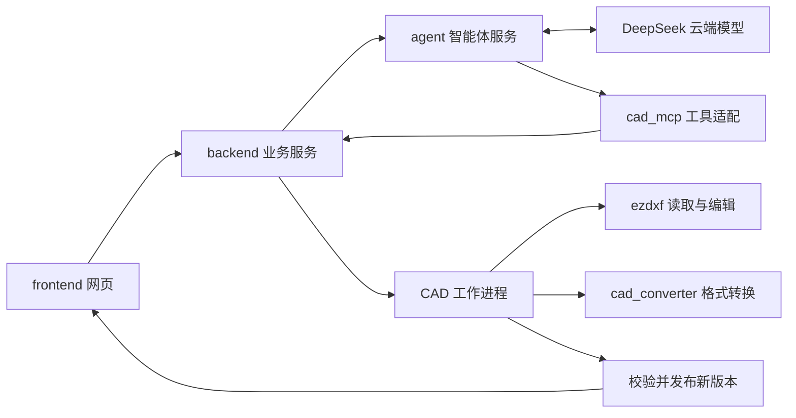

# CAD 图纸助手

这是一个在本机运行的 CAD 工作台：浏览器负责看图和对话，后端管理图纸与版本，智能体调用模型和 CAD 工具。当前支持 DWG/DXF 上传、SVG 预览、查询、基础编辑和版本追溯。

## 1. 先认识五个组件

```text
cad-agent/
├── frontend/             网页：聊天、看图、上传、版本切换
├── backend/              业务后端：图纸、任务、版本和 CAD 操作
│   └── app/cad/          读取、渲染、编辑、几何检查
├── agent/                智能体组件：配置、接入代码和可修改的引擎源码
│   ├── launcher.py       启动服务，组合模型与工具配置
│   ├── client.py         后端访问智能体的 HTTP/SSE 适配
│   ├── config.json       模型与 MCP 工具配置
│   ├── prompts/cad.txt   助手的工作规则
│   ├── engine/           固定版本的 TypeScript 引擎源码，纳入版本控制
│   └── node_modules/     安装好的发行程序，不作为开发源码
├── cad_mcp/              将 CAD 功能暴露为模型可调用的工具
├── cad_converter/        DWG/DXF 转换组件
│   ├── install.sh        安装第三方转换器
│   ├── run.sh            本项目维护的转换器调用入口
│   └── runtime/          ODA 二进制程序，不提交 Git
├── scripts/              整个项目的安装、启动和验收脚本
├── assets/fonts/         开源中文字体及用户自备字体目录
├── samples/              合成样图与本机私有工程图
├── tests/                本项目的后端/CAD/智能体集成测试
└── docs/                 接口、能力边界与验证记录
```

`agent/` 是我们的组件名称，当前引擎来源是 OpenCode v1.18.31。它的完整源码已导入 `agent/engine/`，可以修改；上游包名和许可证保留。配置、提示词、通信适配不再散落在根目录、`scripts/` 和 `tooling/` 中。

`cad_converter/` 也作为根目录组件管理，但 **ODA File Converter 是第三方二进制发行程序，不是可任意修改的开源引擎**。我们能修改它的安装、调用和转换策略；CAD 编辑代码主要在 `backend/app/cad/`。不能通过改目录名称把 ODA 变成自有源码。

| 想改什么 | 从哪里开始 |
| --- | --- |
| 网页按钮、布局、图纸交互 | `frontend/src/` |
| 上传、另存新图、版本发布 | `backend/app/api/`、`jobs.py`、`store.py` |
| 删除、裁剪、读取块内实体等 CAD 能力 | `backend/app/cad/`，再接入 `cad_mcp/server.py` |
| 助手如何描述任务、何时提问 | `agent/prompts/cad.txt` |
| 模型连接、工具配置、启动方式 | `agent/config.json`、`launcher.py`、`runtime.py` |
| 模型循环、上下文处理、引擎内部机制 | `agent/engine/`，入口见 [智能体开发说明](agent/README.md) |
| DWG 转换器安装与调用 | `cad_converter/` 和 `backend/app/cad/converter.py` |

## 2. 一次对话如何执行



智能体负责理解任务和选择工具；CAD MCP 负责把调用转给后端；真正修改图元的是 CAD 代码。**配置允许某个工具，不等于这个工具已经实现了所有 CAD 操作。** 模型说“完成”也不会自动生成新图：必须由后端完成处理并发布版本，网页才更新。

上传时，DWG 先转为工作 DXF，再读取实体并生成预览；DXF 可直接导入。上传和本地看图不需要模型。使用智能对话时，工具查出的文字或图片会按任务发送给模型。

前端看图默认使用 SVG，可切换 PNG；它显示后端生成的预览，目前还不是能直接点选和拖动实体的 CAD 编辑器。

## 3. 安装与启动

当前脚本面向 Ubuntu 24.04 / Linux x86_64，Windows 可使用 WSL2。新主机不能只安装 Python requirements；项目还需要 Node、智能体和 DWG 转换器。

新主机先准备系统环境：

```bash
sudo apt update
sudo apt install -y python3 python3-pip python3-venv git curl ca-certificates \
  tar xz-utils fontconfig fonts-noto-cjk xvfb xauth \
  libgl1 libegl1 libxkbcommon-x11-0 libxcb-cursor0
```

克隆私有仓库并安装：

```bash
git clone https://github.com/Magnificent2003/cad-agent.git
cd cad-agent
bash scripts/bootstrap.sh
bash cad_converter/install.sh
```

`bootstrap.sh` 安装项目内的 uv、Node、Python 依赖、智能体发行程序及前端依赖，构建前端，并按 `.env.example` 补齐本地配置。它不会覆盖已有模型密钥。DWG 转换器单独安装；只用 DXF 时可暂不安装。

在 `.env` 中填写 `DEEPSEEK_API_KEY`。主要设置：

| 设置 | 用途 |
| --- | --- |
| `DEEPSEEK_BASE_URL` / `DEEPSEEK_MODEL` | 模型接口与名称 |
| `AGENT_BASE_URL` | 智能体服务地址，默认 `http://127.0.0.1:4096` |
| `AGENT_SERVER_USERNAME` / `AGENT_SERVER_PASSWORD` | 智能体 HTTP/SSE 认证；密码由配置脚本生成 |
| `AGENT_RUNTIME` | `release` 使用发行程序，`source` 运行本项目里的引擎源码 |
| `CAD_INTERNAL_TOKEN` | CAD 内部工具接口令牌，由配置脚本生成 |
| `ODA_EXECUTABLE` | 默认 `./cad_converter/run.sh` |
| `ODA_USE_XVFB` | 无桌面 Linux 设 `true`；有 WSLg 时通常为 `false` |
| `CAD_FONT_DIRS` | 附加字体目录，Linux 下用冒号分隔 |
| `CAD_DATA_DIR` | 业务数据目录，默认 `./data` |

新增设置同步维护 `.env.example` 与 `.env`，示例文件留空真实凭据。原来的 `OPENCODE_*` 服务设置保留读取兼容，新代码统一使用 `AGENT_*`。

日常从根目录启动：

```bash
bash scripts/dev.sh
```

打开 **http://127.0.0.1:5173**。终端会显示日志；`Ctrl+C` 停止三个服务。安装完成不会自动启动服务，项目也没有配置开机自启。

| 服务 | 开发端口 | 单独启动（先停止统一启动的服务） |
| --- | --- | --- |
| 网页 Vite | 5173 | `source scripts/env.sh` 后执行 `npm run dev --prefix frontend` |
| 业务后端 FastAPI | 8000 | `source scripts/env.sh` 后执行 `python -m uvicorn backend.app.main:app --host 127.0.0.1 --port 8000 --workers 1` |
| 智能体 | 4096 | `bash agent/start.sh` |

检查已有服务：

```bash
ss -ltnp '( sport = :5173 or sport = :8000 or sport = :4096 )'
curl --noproxy '*' http://127.0.0.1:8000/api/health
```

`agent: connected` 表示智能体可连接；`dwg_available` 表示转换器文件已安装，真实转换仍需验收。后端 API 文档在 `http://127.0.0.1:8000/docs`。若提示端口已占用，先检查原服务，不要重复启动。后台运行时日志由启动它的终端或重定向文件保存；关浏览器不会关闭服务。

只测试本地看图可运行 `bash scripts/dev.sh --without-agent`。构建后运行 `bash scripts/dev.sh --production` 则由后端提供网页，访问 **8000**，不再启动 Vite；先执行 `npm run build --prefix frontend`。

## 4. 修改智能体源码怎么生效

发行程序与源码是两种运行方式。改 `agent/config.json`、提示词或接入代码后，重启即可生效。改 `agent/engine/` 内的 TypeScript 代码，则需要运行源码模式：

```bash
bash agent/install.sh --source
AGENT_RUNTIME=source bash scripts/dev.sh
```

源码依赖由 Bun 1.3.14 与 `agent/engine/bun.lock` 固定，来源记录在 `agent/source.lock.json`。安装脚本不会覆盖你修改的引擎源码。切换前停止原服务；回到发行版使用 `AGENT_RUNTIME=release bash scripts/dev.sh`。

这两种模式共用项目的模型配置、CAD MCP 和会话数据库；源码版本号显示 `local` 是上游的正常行为。详细源码入口、依赖和许可见 [agent/README.md](agent/README.md)。

## 5. 代码、安装产物与业务数据如何区分

| 目录 | 内容 | 能否删除 / 如何恢复 |
| --- | --- | --- |
| `agent/engine/` | 可修改的引擎源码 | 属于源码，应保留并纳入版本控制 |
| `agent/node_modules/` | 已安装的智能体发行程序 | 可重装：`bash agent/install.sh` |
| `agent/engine/**/node_modules/` | 源码模式的依赖 | 可重装：`bash agent/install.sh --source` |
| `cad_converter/runtime/` | ODA 二进制及运行库 | 可重装：`bash cad_converter/install.sh` |
| `.tools/` | Node、uv、Bun、GitHub CLI 等开发工具 | 不是纯缓存；删除后相应命令不可用，需重装 |
| `.venv/`、`frontend/node_modules/` | Python / 前端依赖 | 可按锁文件重装 |
| `.cache/` | 下载、依赖及测试浏览器缓存 | 可按需清理；测试浏览器删除后需重新安装 |
| `data/` | 图纸原件、版本、派生预览、任务及 SQLite | 业务数据，删除会丢图，先备份 |
| `.runtime/agent/` | 智能体对话数据库和状态 | 与 `data/` 一起备份，不能当普通缓存清空 |
| `samples/private/` | 本机真实施工图材料 | 不提交 Git，需要单独备份与迁移 |
| `assets/fonts/noto/` | 随项目分发的两款开源中文字体与许可证 | 随代码保留 |
| `assets/fonts/local/` | 用户有使用权的原图字体 | 自动扫描，不提交 Git |

本机的旧路径 `.runtime/opencode` 保留为指向 `.runtime/agent` 的兼容链接，让历史会话中保存的旧绝对路径继续有效；实际数据只保留一份。旧数据库迁移备份位于本机 `.runtime/migrations/`。没有改写图纸原件或已有版本。

`.gitignore` 排除密钥、真实工程图、业务数据、安装产物和缓存。**克隆代码不等于恢复旧机器的数据与密钥。** 私有仓库也不应提交 `.env`。

## 6. 当前 CAD 能力边界

已有：读取原生文字与坐标、分页查询、改文字、平移指定实体、新增文字/矩形/折线、导出 DXF/DWG、创建修订版本、按明确规则检查几何。

尚未实现：删除实体、按图框裁剪、另存为独立图纸记录、完整递归查询块内对象、图框识别和点选、天正专有对象编辑。增加权限或只改提示词不会补齐这些实现。首期没有安装 FreeCAD MCP，使用的是自建 CAD MCP + ezdxf；原因和下一步见 [CAD 能力诊断与计划](docs/cad-roadmap.md)。

预览支持中文回退字体和旧式文字编码，已上传图纸可按新字体配置更新预览缓存。天正对象只按可用代理图形显示，不能保证专业对象保真编辑；详见 [字体兼容记录](docs/font-compatibility.md)。规范 RAG 尚未接入，不能宣称完成真实规范审查。

## 7. 验证和详细文档

```bash
source scripts/env.sh
pytest -q
ruff check agent/*.py backend cad_mcp scripts tests
npm run build --prefix frontend
NO_PROXY=127.0.0.1,localhost no_proxy=127.0.0.1,localhost npm run test:e2e --prefix frontend
python scripts/verify_agent.py
python scripts/verify_cad.py 'samples/private/白桥室外施工图纸/白桥二期绿化施工图0414/入口标识.dwg' --out data/manual-check --export-dwg
```

浏览器测试需先安装 Chromium：`cd frontend && npx playwright install chromium`。`verify_agent.py` 默认只检查服务与 MCP；`--cad` / `--vision` 才会对合成测试数据调用真实模型并产生 API 费用。引擎上游测试从各自包目录执行，不要把本项目测试与整个上游仓库测试混为一套。

- [智能体组件与源码开发](agent/README.md)
- [转换器组件](cad_converter/README.md)
- [业务架构和接口](docs/architecture.md)
- [架构重构记录](docs/refactor-validation.md)
- [CAD 能力诊断与下一步](docs/cad-roadmap.md)
- [环境记录](docs/environment.md)
- [CAD 验收](docs/cad-validation.md)、[模型链路验收](docs/agent-validation.md)、[前端验收](docs/frontend-validation.md)
- [初始部署指南](CAD-Agent_Phase1_Deployment_Guide.md)：保留为方案背景，实际目录与启动命令以本 README 为准
