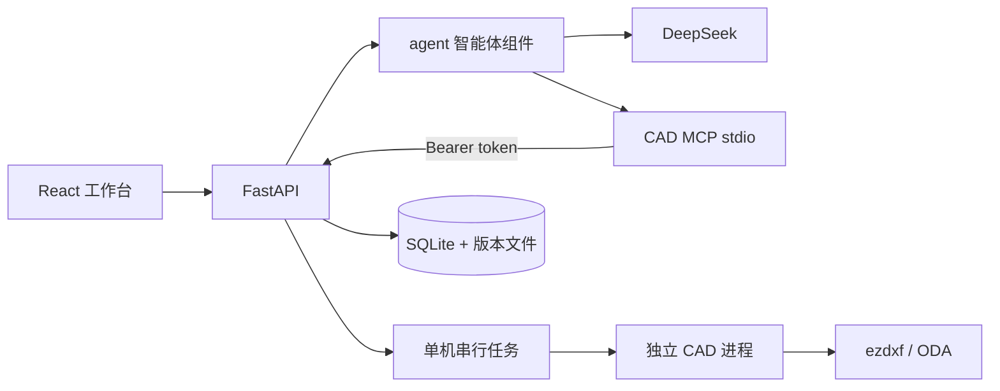

# 第一阶段架构与接口

## 状态与版本

原件位于 `data/drawings/{drawing_id}/source/original.dwg|dxf`，旁边保存 SHA-256。版本位于 `revisions/r0001/`，包含 `drawing.dxf`、`metadata.json`、`manifest.json`、`changes.json` 和预览。其它布局/范围是独立预览缓存。所有路径由服务器从数据库标识构造，MCP 不接收任意文件路径。

上传先保存原件，再创建导入任务。修改读取 `expected_revision`，在任务入队、运行、发布前分别核对。候选输出写入独立任务目录；重读、差异核对及渲染通过后才重命名到版本目录并更新数据库。新版本行、当前版本指针与任务成功状态在同一 SQLite 事务中提交。重命名后但数据库提交前宕机留下的无引用候选，在下一次对应发布时清理。

任务状态：`queued → running → succeeded|failed`；取消为 `queued → cancelled` 或 `running → cancelling → cancelled`。进程重启将未完成任务标记 `interrupted`。停止会话先禁止新写入，再请求 OpenCode abort 并取消该会话的 CAD 任务；转换子进程跟随 worker 结束。已经提交的新版本保留，可通过恢复接口再创建版本。

`operation_id` 在一张图纸内唯一；相同请求重试返回已有任务，不同内容复用编号返回 409。DXF 句柄只在图纸及版本上下文内解释，DWG 再导入后不依赖句柄恒定。

会话绑定图纸；每会话只允许一个活动请求。产品接口只代理明确的会话能力，不透传 OpenCode shell、文件读取或配置接口。所有 OpenCode 请求，包括 SSE，使用 BasicAuth。浏览器事件按会话归属过滤并剔除推理正文及服务端上下文；断连后恢复历史与图纸版本。

## 主要接口

| 方法 | 路径 | 返回/用途 |
| --- | --- | --- |
| GET | `/api/health` | CAD/智能体/RAG 状态 |
| GET/POST | `/api/projects` | 项目列表/创建 |
| GET/POST | `/api/drawings` | 图纸列表/默认项目上传 |
| POST | `/api/projects/{id}/drawings` | 上传，返回 drawing_id、job_id |
| GET | `/api/drawings/{id}` | 当前版本、元数据、状态 |
| GET | `/api/drawings/{id}/revisions` | 全部已发布版本 |
| GET | `/api/drawings/{id}/revisions/{rev}/preview` | `layout` 与 `format=svg|png` |
| GET | `/api/drawings/{id}/revisions/{rev}/download` | `format=dxf|dwg|png`，DWG 按需验证导出 |
| POST | `/api/drawings/{id}/revisions/{rev}/restore` | body `expected_revision`，创建恢复版本 |
| GET | `/api/jobs/{id}` | 任务状态、结果、失败原因 |
| POST | `/api/jobs/{id}/cancel` 或 `/retry` | 取消或显式重试 |
| GET/POST | `/api/drawings/{id}/sessions` | 会话历史/创建 |
| GET/POST | `/api/sessions/{id}/messages` | 历史/异步发送，body `text, expected_revision` |
| GET | `/api/sessions/{id}/events` | SSE；drawing.updated 才触发版本更新 |
| GET/POST | `/api/sessions/{id}/status`、`/abort` | GET 状态、POST 停止 |

内部 `/internal/` 必须携带 `Authorization: Bearer CAD_INTERNAL_TOKEN`。提供图纸概况、query、edit、render、export、checks、jobs 和 rag/status；排队工具传 `session_id` 用于停止关联和会话归属校验。输入输出模型及完整路由见运行中的 `/docs`。

## 几何检查

`ConstraintSpec` 接受明确 `targets`、`predicate`、`unit`、`parameters` 和来源类型。`within_site` 使用 `parameters.site_handle`，`no_overlap` 要求闭合轮廓，`min_distance` 使用 `parameters.minimum`。缺少单位、对象、适用条件或可计算几何时返回 unknown；不将没有证据解释为符合规范。道路中心线不提供道路净宽结论。

RAG 默认返回 `not_configured`。`ClauseEvidence`、`ConstraintSpec`、`CheckResult` 已定义，为后续真实条款服务保留标准号、版本、证据、适用范围及附件字段。

## 运行边界

这是单用户本机原型，API 必须使用一个 Uvicorn 服务进程。多个 worker 会各自持有队列，无法满足此版本的一致性约束。任务队列在内存，记录在 SQLite；重启后需明确重试。大图耗时工作在隔离 CAD 进程，健康检查与对话事件无需等待 CAD 完成。

OpenCode 对话数据库保存在 `.runtime/agent/`，与 CAD SQLite 中的会话映射共同组成历史；不要仅复制其中一个目录来迁移会话。

## 组件边界

智能体配置、启动、通信适配和固定来源引擎源码统一在 `agent/`。`backend` 通过 `agent/client.py` 访问服务，项目配置使用 `AGENT_*`；上游要求的环境变量只在 `agent/runtime.py` 做适配。`cad_converter/` 提供项目维护的安装/运行脚本，二进制放在忽略版本控制的 `runtime/`。CAD MCP 和原生操作仍分别在 `cad_mcp/`、`backend/app/cad/`。

`agent/engine/` 是引擎源码，`agent/node_modules/` 是发行程序；修改前者需使用 source 模式。源码和发行版显式使用同一个会话数据库，历史工作目录由兼容符号链接保留。架构整理没有新增删除、裁剪或另存工具，相关计划见 [CAD 能力诊断](cad-roadmap.md)。
